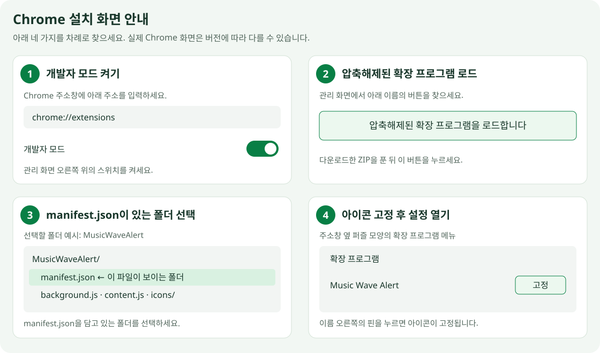

# Music Wave Alert

PC의 Chrome에 설치해 멜론 MUSIC WAVE의 **계속 듣기 창을 자동으로 확인**하고, 경고 창이나 재생 중단을 **PC·휴대폰 알림**으로 알려주는 확장 프로그램입니다.

**[v1.3.3 설치용 ZIP 내려받기](https://github.com/Junho1224/musicwave-chrome-extension/raw/refs/heads/main/release/music-wave-alert-extension-v1.3.3.zip)**

처음 설치하면 **자동 확인과 PC 알림이 켜져 있습니다.** 자동 새로고침과 휴대폰 알림은 필요할 때 선택하세요. 확장 프로그램은 PC에서 실행하며, 휴대폰은 알림을 받는 데 사용합니다.

[빠른 시작](#quick-start) · [설치하기](#install) · [처음 실행](#first-run) · [설정표](#settings) · [휴대폰 연결](#mobile) · [문제 해결](#troubleshooting) · [업데이트](#update)

<a id="quick-start"></a>

## 빠른 시작

1. **ZIP을 내려받아 압축을 풀고 Chrome에 설치합니다.** 처음 설치한다면 아래 [설치하기](#install)를 순서대로 따라 하세요.
2. **MUSIC WAVE에서 음악을 재생하고 페이지를 새로고침합니다.** 로그인과 음악 재생은 MUSIC WAVE 페이지에서 먼저 진행하세요.
3. **Music Wave Alert 아이콘을 열고 PC 테스트 알림을 확인합니다.** 일반 계속 듣기 창은 기본 설정으로 자동 확인합니다. 휴대폰 알림이 필요하면 [휴대폰 연결](#mobile)까지 진행하세요.

<a id="install"></a>

## 1. Chrome에 설치하기

PC용 Chrome과 [멜론 MUSIC WAVE](https://musicwave.melon.com/)를 준비하세요. Chrome 웹 스토어에 등록된 버전이 아니므로, 내려받은 폴더를 **개발자 모드**로 불러옵니다. 별도 프로그램 설치나 코딩은 필요하지 않습니다.

1. 위의 **설치용 ZIP 내려받기**를 누릅니다. 파일 이름은 `music-wave-alert-extension-v1.3.3.zip`입니다. GitHub 파일 화면이 열리면 **Download raw file**을 눌러 받으세요.
2. ZIP의 압축을 풉니다. Windows에서는 파일을 마우스 오른쪽 버튼으로 눌러 **모두 압축 풀기**를 선택하면 됩니다.
3. 압축을 푼 폴더 안에 `manifest.json`이 있는지 확인합니다. 이 파일이 들어 있는 폴더가 설치할 폴더입니다.
4. Chrome 주소창에 `chrome://extensions`를 붙여넣고 Enter를 누릅니다.
5. 오른쪽 위의 **개발자 모드**를 켭니다.
6. **압축해제된 확장 프로그램을 로드합니다**를 누르고, 3번에서 확인한 **폴더**를 선택합니다.
7. 목록에 **Music Wave Alert 1.3.3**이 표시되고 사용 스위치가 켜져 있는지 확인합니다.
8. Chrome 주소창 오른쪽의 **퍼즐 모양 아이콘**을 누른 뒤, **Music Wave Alert** 옆의 **핀 모양 아이콘**을 눌러 고정합니다. 이제 고정된 아이콘으로 설정을 열 수 있습니다.

폴더를 선택할 때 아래와 같이 `manifest.json`이 바로 보이면 됩니다. 폴더가 한 겹 더 있다면 안쪽 폴더를 확인하세요.

```text
MusicWaveAlert/       ← 이 폴더를 선택
├─ manifest.json
├─ background.js
├─ content.js
└─ icons/
```

압축을 푼 폴더는 앞으로도 사용할 위치에 계속 보관하세요. Chrome은 그 폴더에서 확장 프로그램을 불러옵니다.



위 이미지는 설치 순서를 설명하는 안내 그림입니다. 실제 Chrome 화면의 모양과 버튼 위치는 버전에 따라 다를 수 있습니다. [Chrome 공식 설치 안내](https://developer.chrome.com/docs/extensions/get-started/tutorial/hello-world#load-unpacked)에서도 화면을 확인할 수 있습니다.

<a id="first-run"></a>

## 2. 처음 실행하고 알림 확인하기

1. [MUSIC WAVE](https://musicwave.melon.com/)를 열고 로그인한 뒤 음악을 재생합니다.
2. 설치 전에 열어두었던 MUSIC WAVE 페이지를 **한 번 새로고침**합니다. 새로고침 후 음악이 실제로 재생되는지도 확인하세요.
3. MUSIC WAVE 탭을 보고 있는 상태에서 고정한 **Music Wave Alert 아이콘**을 누릅니다.
4. 상단에 **현재 탭 감시 중**이 포함된 문구가 나타나는지 확인합니다. 아래에는 **탭 감시 등록됨**이 표시됩니다. 재생 상태를 파악하는 동안에는 **재생 상태 확인 중**이라고 나올 수 있습니다.
5. **데스크톱 알림**이 켜져 있는 상태에서 **PC 테스트 알림 보내기**를 누릅니다. 버튼의 성공 문구와 함께 **실제 PC 시스템 알림이 도착하는지** 확인합니다.
6. **계속 듣기 자동 확인**이 켜져 있는지 확인합니다. 설정은 바꾸는 즉시 자동 저장됩니다.

이제 MUSIC WAVE 탭을 열어둔 채 사용하면 됩니다. 확장 설정 창은 닫아도 됩니다. 휴대폰에서도 알림을 받으려면 [다음 연결 안내](#mobile)를 진행하세요.

<a id="settings"></a>

## 3. 내게 맞는 설정 고르기

표의 기본값은 **처음 설치했을 때** 기준입니다. 기존 사용자는 저장된 설정이 적용됩니다.

| 설정 이름 | 기본값 | 하는 일 |
| --- | --- | --- |
| 데스크톱 알림 | 켜짐 | 경고·재생 중단 등을 PC 시스템 알림으로 알립니다. |
| 페이지 경고음 | 켜짐 | PC 알림을 사용할 때 페이지에서 경고음을 냅니다. |
| 탭 제목 깜빡임 | 켜짐 | PC 알림을 사용할 때 탭 제목을 깜빡입니다. |
| 재생 중단 알림 (15초 이상) | 켜짐 | 한 번 재생한 음악의 재생 시간이 15초 이상 진행하지 않으면 알립니다. |
| MUSIC WAVE 탭 종료 알림 | 켜짐 | 마지막 MUSIC WAVE 탭을 닫거나 다른 주소로 이동하면 알립니다. |
| 계속 듣기 자동 확인 | 켜짐 | 일반 계속 듣기 창의 확인 버튼을 한 번 누릅니다. |
| 계속 듣기 자동 새로고침 | 꺼짐 | 일반 계속 듣기 창이 뜨면 해당 탭을 새로고침합니다. |
| 휴대폰 알림 | 꺼짐 | 연결한 휴대폰으로 알림을 보냅니다. [처음 한 번 연결](#mobile)이 필요합니다. |

### 자동 확인과 자동 새로고침 중 선택하기

기본 설정인 **계속 듣기 자동 확인**을 켜두면 “지금 듣고 계신 음악을 계속 들으시겠습니까?” 창의 **확인**을 한 번 누릅니다. “들으 시겠습니까?”처럼 문구에 띄어쓰기나 줄바꿈이 있어도 감지합니다.

새로고침 방식이 좋다면 **계속 듣기 자동 새로고침**을 켜세요. 자동 확인은 함께 꺼집니다. 반대로 자동 확인을 켜면 자동 새로고침이 꺼지며, 둘 다 끄면 계속 듣기 창을 알림으로만 알려줍니다.

자동 처리는 알려진 일반 계속 듣기 창에 적용됩니다. **기계적 스트리밍 경고나 인증·CAPTCHA가 표시되면 MUSIC WAVE 탭에서 직접 확인하고 인증하세요.** 자동 처리를 시도해도 창이 남거나 실패하면 기존 알림으로 알려줍니다. 새로고침은 같은 창에서 한 번만 시도하고 탭별로 최소 60초 간격을 두어 반복 실행을 제한합니다.

### 재생 중단·탭 종료 알림 알아두기

직접 음악을 **15초 이상 일시정지**한 경우에도 재생 중단 알림이 올 수 있습니다. 자주 일시정지한다면 **재생 중단 알림 (15초 이상)**을 꺼두세요. 짧은 곡 전환이나 버퍼링은 기다렸다가 다시 확인합니다.

MUSIC WAVE 탭을 여러 개 열었다면 **마지막 탭**이 닫힐 때 탭 종료 알림을 보냅니다. 주기 확인은 약 30초 간격으로 동작해 알림이 늦게 올 수 있습니다. **PC 절전, Chrome 종료, Chrome의 탭 중지 상태에서는 알림·자동 처리가 중단되거나 지연될 수 있습니다.**

<a id="mobile"></a>

## 4. 휴대폰 알림 연결하기 — 선택 기능

PC 알림만 필요하면 이 단계는 건너뛰어도 됩니다. 휴대폰 알림에는 **ntfy**라는 알림 서비스를 사용합니다.

1. PC에서 **Music Wave Alert 아이콘**을 열고 **휴대폰 알림**을 켭니다.
2. 권한 안내가 나오면 `ntfy.sh` 연결 권한을 허용합니다.
3. **휴대폰 연결 만들기**를 누릅니다. 이미 연결 주소가 만들어져 있으면 **연결 화면 열기**로 표시됩니다.
4. 새로 열린 연결 화면의 **QR 코드**를 휴대폰 카메라로 스캔합니다.
5. 휴대폰에서 **ntfy 앱으로 받기** 또는 **앱 없이 웹으로 받기**를 선택하고 안내에 따라 연결합니다.
6. 휴대폰에서 앱 또는 웹 알림 권한을 허용합니다. 웹 방식의 iPhone은 **iOS 16.4 이상에서 Safari로 열고 홈 화면에 추가**한 웹 앱에서 알림을 설정하세요. 자세한 방법은 [ntfy 공식 웹 앱 안내](https://docs.ntfy.sh/subscribe/pwa/#safari-on-ios)를 참고하세요.
7. PC로 돌아와 **휴대폰 테스트**를 누릅니다. **실제 휴대폰 시스템 알림이 도착하면 연결 완료**입니다.

연결 화면은 PC 확장의 버튼으로 여세요. 이 과정에서 개인 알림 채널이 포함된 주소가 만들어집니다. 테스트가 끝나면 연결 화면은 닫아도 됩니다. **QR 코드와 개인 연결 주소는 다른 사람에게 공유하지 마세요.**

<a id="troubleshooting"></a>

## 5. 잘 안 될 때 확인하기

| 보이는 증상 | 먼저 확인할 순서 |
| --- | --- |
| 설치할 때 `manifest.json`을 찾을 수 없다고 나와요. | ZIP 압축을 풀었는지 확인 → 압축을 푼 폴더 안의 `manifest.json` 확인 → 그 파일을 담고 있는 폴더를 선택하세요. |
| 확장 아이콘이 안 보여요. | 주소창 오른쪽 퍼즐 메뉴 → Music Wave Alert 옆의 핀을 누르세요. |
| 감시 중이 표시되지 않아요. | MUSIC WAVE 탭으로 이동 → 페이지 새로고침 → 확장 아이콘을 다시 열어보세요. 계속 안 되면 `chrome://extensions`에서 확장이 켜져 있는지 확인하세요. |
| PC 테스트 알림이 안 와요. | 데스크톱 알림 켜기 → PC의 Chrome 알림 허용 및 방해 금지·집중 모드 확인 → 다시 테스트하세요. Windows에서는 **설정 → 시스템 → 알림**을 확인하세요. [Windows 알림 안내](https://support.microsoft.com/ko-kr/windows/experience/notifications-and-do-not-disturb-in-windows) |
| 휴대폰 테스트 알림이 안 와요. | 휴대폰 알림 켜기 → PC 확장의 연결 화면에서 다시 연결 → 휴대폰 앱·웹의 알림 권한 확인 → 다시 테스트하세요. ntfy 화면에 메시지는 보이는데 시스템 알림만 안 오면 휴대폰 알림·백그라운드 설정을 확인하세요. |
| 계속 듣기 창이 자동으로 처리되지 않아요. | 자동 확인 또는 자동 새로고침 중 하나를 켰는지 확인 → MUSIC WAVE 페이지 새로고침 → 창에 기계적 스트리밍 경고나 인증이 있는지 확인하세요. 일반 창이 계속 남으면 **마지막 자동 확인/새로고침 시도**와 **마지막 감지**를 확인하세요. |
| 음악을 직접 멈췄는데 알림이 와요. | 15초 이상 멈추면 알릴 수 있습니다. 필요하면 재생 중단 알림을 끄세요. |
| 업데이트했는데 이전 버전이 보여요. | 아래 [업데이트 순서](#update)대로 기존 설치 폴더의 파일을 교체하고 **확장을 새로고침**한 뒤 MUSIC WAVE 페이지도 새로고침하세요. |

확장 팝업의 **마지막 감지** 아래에서 PC·휴대폰 전송 결과와 오류를 확인할 수 있습니다. PC 알림에 실패해도 휴대폰 전송은 별도로 시도하며, 경고가 유지되면 실패한 채널만 간격을 두고 재시도합니다.

계속 문제가 생기면 [GitHub Issues](https://github.com/Junho1224/musicwave-chrome-extension/issues)에 **확장 버전, 문제 상황, 테스트 알림 수신 여부, 팝업의 상태·오류 문구**를 적어주세요. 화면을 첨부할 때 개인 연결 주소와 QR 코드는 가려주세요.

<a id="update"></a>

## 6. 기존 사용자가 업데이트하기

이 방식으로 설치한 확장은 **새 ZIP을 받아 직접 업데이트**합니다. 기존 항목을 유지한 채 같은 폴더의 파일을 교체하면 저장된 설정과 휴대폰 채널을 유지할 수 있습니다.

1. 이 README 맨 위에서 새 설치용 ZIP을 내려받아 **임시 폴더에 압축을 풉니다**.
2. `chrome://extensions`에서 **개발자 모드**를 켜고, 기존 Music Wave Alert의 **세부정보**에서 **로드 위치** 경로를 확인합니다. 이것이 이전에 설치할 때 선택한 폴더입니다.
3. 1번에서 압축을 푼 폴더 안의 `manifest.json`, JavaScript 파일, `icons` 폴더 등을 **기존 설치 폴더에 복사해 덮어씁니다**. 새 폴더 자체를 넣기보다, `manifest.json`이 기존과 같은 위치에 있도록 안의 파일·폴더를 복사하세요.
4. `chrome://extensions`의 Music Wave Alert 항목에서 **새로고침 아이콘(둥근 화살표)**을 누릅니다. 단순히 확장 목록 페이지를 새로고침하는 것과 구분하세요.
5. 항목의 버전이 이 README 맨 위의 버전과 일치하는지 확인합니다.
6. MUSIC WAVE 페이지도 새로고침하고, 음악 재생과 **PC 테스트 알림**을 확인합니다. 휴대폰을 연결했다면 **휴대폰 테스트**도 확인하세요.

1.3.3으로 처음 업데이트할 때 자동 확인·새로고침이 모두 꺼져 있었다면 **자동 확인을 한 번 켭니다**. 기존에 자동 새로고침을 선택했다면 그대로 유지하며, 이후 직접 끄면 다음 확장 새로고침이나 업데이트에서도 꺼진 상태를 유지합니다.

## 개인정보와 사용 범위

휴대폰 알림을 켜면 경고 종류에 맞는 알림 제목·내용을 `ntfy.sh`로 전송합니다. 채팅 내용과 계정 정보는 전송하지 않습니다. 알림은 사용자가 MUSIC WAVE 상태를 확인하도록 돕는 기능이며, 기계적 스트리밍 인증이나 CAPTCHA는 직접 진행해야 합니다.

## 선택 팁: 탭별 볼륨 조절

[Volume Master](https://chromewebstore.google.com/detail/volume-master/jghecgabfgfdldnmbfkhmffcabddioke)를 사용하면 Chrome 탭마다 볼륨을 조절할 수 있습니다. 탭을 음소거하면 페이지 경고음도 들리지 않을 수 있으므로 PC 알림 또는 휴대폰 알림을 함께 켜두세요.

## 변경 내역

### v1.3.3

- 일반 계속 듣기 창의 자동 확인을 기본으로 켬
- 기존에 두 자동 동작이 모두 꺼져 있으면 업데이트 때 한 번 활성화하고, 자동 새로고침 선택과 이후 끄기 설정은 유지
- “계속 들으 시겠습니까?”처럼 띄어쓰기·줄바꿈으로 나뉜 문구도 감지

<details>
<summary>이전 버전 변경 내역 보기</summary>

### v1.3.2

- 일반 계속 듣기 창에 자동 새로고침 옵션 추가
- 자동 확인과 새로고침 중 한 동작만 선택하도록 설정
- 백그라운드에서 현재 탭·설정·창을 재검사하고, 새로고침 및 서비스 워커 재시작 후에도 60초 제한 유지
- 실패하거나 창이 남으면 기존 알림으로 전환

### v1.3.1

- 사용자가 켤 수 있는 계속 듣기 자동 확인 옵션 추가
- 실제 확인 버튼을 창이 표시될 때 한 번 클릭하고, 창이 유지되면 알림으로 전환
- 기계적 스트리밍·인증 창은 자동 처리하지 않음

### v1.3.0

- 체크섬과 압축 데이터가 손상된 PC 알림 PNG 아이콘을 정상 파일로 교체
- PC 알림 오류 때문에 휴대폰 알림과 마지막 감지 기록까지 중단되던 경로 수정
- 경고 창 없는 재생 중단도 오디오 시간·재생 이벤트로 감지
- 알려진 경고 모달을 페이지 전체 텍스트 검사보다 먼저 확인
- 실패한 채널만 재시도하고, 경고가 떠 있는 동안 알림을 켜도 전송
- 백그라운드 주기 확인에서 페이지 경고·재생 상태도 검사
- 팝업에 재생 중단 설정과 알림 전송 결과 표시

### v1.2.6

- 탭 활성화·로딩 시 MUSIC WAVE 탭을 백그라운드에서 직접 등록
- 확장 프로그램 팝업에 탭 감시 등록 수와 주기 확인 상태 표시
- 탭 감시 오류를 팝업에서 확인할 수 있도록 진단 정보 추가

### v1.2.5

- 확장 프로그램 새로고침 후 폐기된 콘텐츠 컨텍스트 오류 방지
- 이미 열려 있는 MUSIC WAVE 탭에 최신 감시 스크립트 자동 재적용
- 중복 감시 스크립트 실행 방지

### v1.2.4

- 탭 종료 이벤트가 누락될 때를 대비한 30초 주기 감시 추가
- Chrome이 실행 중인 동안 실제 MUSIC WAVE 탭 존재 여부 재확인

### v1.2.3

- 페이지 종료 직전 신호를 확인하는 직접 탭 종료 감지 추가
- 새로고침과 실제 탭 종료를 1.2초 후 재확인해 구분
- MUSIC WAVE 탭 감시 등록을 주기적으로 보강

### v1.2.2

- MUSIC WAVE 페이지와 백그라운드의 이중 탭 종료 감지 적용
- 열린 MUSIC WAVE 탭 ID를 직접 등록해 마지막 탭 종료 판별 강화

### v1.2.1

- 확장 프로그램 업데이트 후 첫 탭 종료를 놓치는 문제 수정
- 이미 열려 있는 MUSIC WAVE 탭을 자동으로 감시 상태에 등록

### v1.2.0

- 마지막 MUSIC WAVE 탭 종료 및 다른 주소 이동 감지
- PC와 연결된 휴대폰으로 탭 종료 알림 전송
- 탭 종료 알림에서 MUSIC WAVE 다시 열기 지원

### v1.1.1

- 실제 MUSIC WAVE 확인·감지 팝업 우선 감지
- 휴대폰 알림 전송 실패 시 제한된 자동 재시도
- 확장 프로그램에서 현재 감지 중인 경고 종류 표시

### v1.1.0

- ntfy 앱·웹을 이용한 휴대폰 알림 추가
- 사용자별 휴대폰 연결 QR 제공
- PC 알림과 휴대폰 알림 개별 설정 지원

</details>

## 개발 검증

빌드 없이 Chrome에 로드하는 Manifest V3 확장 프로그램입니다.

```powershell
node --test .\tests\*.test.js
Get-ChildItem -Recurse -Filter *.js | Where-Object { $_.FullName -notmatch '\\release\\' } | ForEach-Object { node --check $_.FullName }
```

알림 아이콘은 `node .\scripts\generate-icons.js`로 다시 만들 수 있습니다. 자동 테스트에는 아이콘 PNG의 체크섬·압축 해제, 실제 content/background 스크립트의 모의 실행, 재생 중단·복구·곡 전환, 채널별 전송 실패, 자동 확인·새로고침의 조건과 재시도 제한이 포함됩니다. 실제 Chrome 동작은 별도로 확인해야 합니다.
